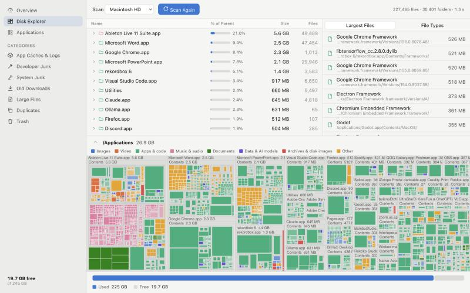
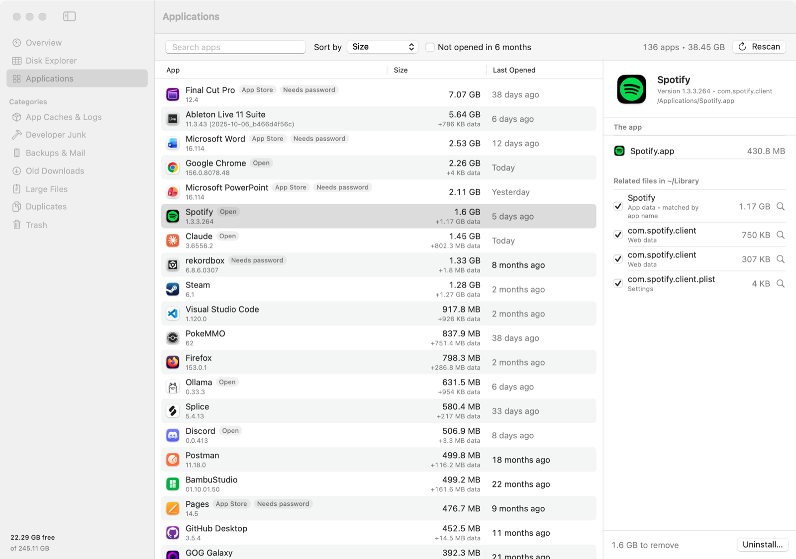

# Mac Cleaner

**See what's filling your disk, and clear it safely. On macOS, Windows and Linux.**

- **Smart cleanup**: finds caches, developer junk, old downloads, duplicates and more, and pre-selects only what's safe to remove.
- **Disk Explorer**: a WizTree-style map of your whole disk, so you can see exactly where the space went.
- **App uninstaller**: every installed app with its real size and when you last opened it, removed together with the files it
  leaves behind.

It comes in two forms, both running on the same Rust engine:

| | Platforms | What it is |
| --- | --- | --- |
| **Mac app** | macOS 14+ | A native SwiftUI app. The most polished experience on a Mac. |
| **Desktop app** | Windows 10/11, Linux, macOS | A [Tauri](https://tauri.app) app (Rust + web UI) with the same features. |

There's also a small `cleaner` command-line tool for scripting.


> [!WARNING]
> **This is vibe-coded software that deletes files.** It was written by an AI model, Claude Opus 5.5, with a person
> steering. It moves things to the Trash or Recycle Bin rather than deleting them outright, and it has guard rails, but it
> hasn't had a line-by-line human review, and the Windows and Linux versions have only been tested by automated checks.
> **Back up first**, check what's selected before you clean, and read the [vibe-coded disclaimer](#vibe-coded-disclaimer).


---

## Features

### Overview & Smart Scan

One button scans every category at once. The disk bar shows how much of your used space can be freed, and **Clean Selected**
removes everything that's ticked, with a confirmation first. While a scan runs you see live progress, and you can stop it any time.

### Cleanup categories

| Category | macOS | Windows | Linux | Pre-selected as safe |
| --- | --- | --- | --- | --- |
| **App caches & logs** | `~/Library/Caches`, `~/Library/Logs` | Temp files older than a day, Chrome/Edge/Firefox caches, INetCache, shader caches | `~/.cache` per app | Yes, except system caches and caches of apps that are **open** |
| **Developer junk** | Xcode DerivedData, device support, simulator caches, Homebrew | npm, pip, Yarn, Go build cache, NuGet | pip, Yarn, Go, pnpm, Maven | Caches yes; `node_modules` only if untouched for 30+ days; Docker and simulators never |
| *(all platforms)* | npm, Cargo, Gradle, Go modules, Docker images/build cache, stale `node_modules` | ← | ← | |
| **System junk** | iPhone/iPad backups, iOS updates, Mail attachments | Crash dumps | | Updates and attachments yes, backups never |
| **Old downloads** | Downloads older than an age you choose | ← | ← | Installers only (`.dmg`/`.pkg`, `.exe`/`.msi`, `.deb`/`.rpm`); archives are flagged but never pre-selected |
| **Large files** | Files over a size you choose, with last-opened date | ← | ← | Never |
| **Duplicates** | Byte-identical files (size → first 64 KB → full BLAKE3), oldest copy kept | ← | ← | Never |
| **Trash / Recycle Bin** | Emptying it | ← | ← | Never (it's permanent) |


### Disk Explorer (WizTree-style)

Pick the whole disk, your home folder, or any folder. It's fast: about 1–2 seconds for `/Applications` (265k files) on a Mac.

- **Storage bar**: the scanned folder, what's selected, the rest of the disk, and free space
- **Folder tree** sorted biggest-first, with a "% of parent" bar on every row
- **Largest Files**: the 1,000 biggest files anywhere, in one list
- **File Types**: total size and count per extension
- **Treemap**: every block's area is the space it takes, colored by type. Double-click to zoom in, hover for details, and
  click a legend entry or file type to highlight those files.
- **Multi-select**: ⌘/Ctrl-click or Shift-click, then **Show** or **Move to Trash** all at once


The desktop app (Windows / Linux / macOS):



### Applications

Every installed app with its real size (the app plus the data it keeps), and when you last opened it. Uninstalling removes the
app and the leftover files you leave ticked.

| | How apps are found | How they're removed |
| --- | --- | --- |
| **macOS** | `.app` bundles in `/Applications` and `~/Applications` | Moved to the Trash (App Store apps via Finder, which asks for your password), leftovers in `~/Library` matched by exact bundle ID |
| **Windows** | The "installed programs" list in the registry, plus Microsoft Store apps | The program's **own uninstaller** (with its UAC prompt), then leftovers in `AppData`; Store apps via `Remove-AppxPackage` |
| **Linux** | Flatpak, Snap, AppImage, and distro packages that appear in your app menu | Flatpak/Snap/your package manager (asks for your password). Refuses if removing a package would also remove other packages |

Built-in system apps, essential packages and the cleaner itself are protected. Steam shortcuts are recognized, so uninstalling
one never takes the game's save files.



---

## Install

### Mac app (recommended on a Mac)

1. Download **`MacCleaner-x.y.z.dmg`** from [Releases](https://github.com/EvanMeyer36/mac-cleaner/releases/latest). It's
   universal (Apple Silicon and Intel) and needs macOS 14 or later.
2. Open it and drag **Mac Cleaner** into **Applications**.
3. **The first time you open it**, macOS says it can't verify the app, because it isn't notarized (that needs a paid Apple
   Developer account). Click **Done**, then go to **System Settings → Privacy & Security** and click **Open Anyway**. Or run:

   ```bash
   xattr -dr com.apple.quarantine "/Applications/Mac Cleaner.app"
   ```

### Desktop app for Windows and Linux

Installers are built by CI on every change. Until they're attached to a release, get them from the latest successful
[CI run](https://github.com/EvanMeyer36/mac-cleaner/actions/workflows/ci.yml) under **Artifacts**:

- **Windows:** the `.msi` or setup `.exe`. Windows SmartScreen will warn that the app is unrecognized, because it isn't
  code-signed. Choose **More info → Run anyway**.
- **Linux:** the `.deb` (Debian/Ubuntu), `.rpm` (Fedora/openSUSE) or `.AppImage` (any distro: `chmod +x` and run it).

### Build from source

| What | Needs | Command |
| --- | --- | --- |
| Mac app | macOS 14+, Xcode Command Line Tools | `cd macos && ./scripts/build-app.sh --install` |
| Desktop app | [Rust](https://rustup.rs), Node.js 20+, and on Linux `libwebkit2gtk-4.1-dev librsvg2-dev` | `cd desktop && npm ci && npx tauri build` |
| CLI | Rust | `cargo build --release -p cleaner-cli` → `target/release/cleaner` |

The CLI's commands:

```bash
cleaner scan [PATH]          # folder sizes, largest files, file types
cleaner junk [--search PATH] # what each cleanup category would offer
cleaner apps                 # installed apps with sizes and leftovers
cleaner trash PATH... --yes  # move things to the trash (same safety rules)
```

Add `--json` to any of them for machine-readable output.

### Permissions

- **macOS** asks the first time Desktop, Documents or Downloads is read. Some places need **Full Disk Access** (System
  Settings → Privacy & Security): the Trash, iPhone backups, and other apps' data.
- **Windows and Linux** don't need special permissions to look around. Uninstalling some programs asks for administrator
  rights.

In the Disk Explorer, space that couldn't be read shows as one hatched "System data" block, so the map still adds up to
your real disk usage.

---

## Safety

Deleting the wrong thing is the worst thing a cleaner can do, so every version shares one set of rules, enforced by the
engine:

- **Scanning never changes anything.** Nothing is removed until you confirm, and the confirmation lists what's about to go.
- **Removal means the OS trash** (Trash / Recycle Bin / freedesktop Trash), so you can put things back. The few permanent
  actions are labelled **Permanent** and called out before you confirm:
  - emptying the trash
  - tool-managed cleanup like `docker image prune`
  - uninstalls done by a program's own uninstaller or package manager
- **Only things inside your home folder can be removed** (plus whole apps in `/Applications` on a Mac).
- **Never removed:**
  - system folders
  - your standard folders themselves (Documents, Library, AppData, …)
  - anything *inside* an app or media library (Photos, Music, Final Cut, …). A file like `Photos.sqlite-wal` looks like junk,
    but deleting it can corrupt your Photos library.
- **Only "safe" items are pre-selected**: things apps rebuild on their own, and never caches of apps that are open.
- **Duplicates that wouldn't free anything** (hard links, cloud files that aren't downloaded) are left out, and online-only
  cloud files are never read.
- **Scans stay on one volume**, so mounted drives, disk images and network shares aren't counted or touched.
- **The desktop app's web UI can't name paths to delete or commands to run.** It refers to items from the latest scan by ID,
  and the Rust backend looks them up.

---

## How it works

### The engine (`core/`)

| Module | What it does |
| --- | --- |
| `tree` | Parallel scan into a size-sorted tree, counting hard links once, staying on one volume, grouping files under 256 KB per folder to keep memory bounded |
| `treemap` | Squarified layout (Bruls, Huizing & van Wijk), breadth-first so the tiniest detail is what's dropped, with a hit-test index for fast hovering |
| `cleanup` | Per-OS rules as data, plus Docker, Downloads and the trash |
| `search` | One walk of a folder that finds large files, duplicates and `node_modules` together |
| `remove` | The single place anything is removed, with the shared protection rules |
| `apps` | Installed apps and uninstall per OS (`apps/macos.rs`, `apps/windows.rs`, `apps/linux.rs`) |

The native Mac app (`macos/`) still has its own Swift engine, with the macOS-specific fast scanner (`getattrlistbulk`) and
APFS clone detection. Moving it onto the shared engine is the next step.

### Project layout

| Path | What's there |
| --- | --- |
| `core/` | Shared Rust engine, with unit and integration tests |
| `cli/` | The `cleaner` command-line tool |
| `desktop/` | Tauri desktop app: `src/` (React UI) and `src-tauri/` (Rust backend) |
| `macos/` | Native SwiftUI Mac app, its bundle resources and build/release scripts |
| `.github/workflows/ci.yml` | Tests and builds on Linux, Windows and macOS for every push |

### Development

- `cargo test --workspace`: engine tests.
- On CI, `CLEANER_TEST_TRASH=1` and `CLEANER_TEST_APPS=1` also run the tests that touch the real trash and app list.
- `npm --prefix desktop run dev` previews the desktop UI in a browser using a stand-in backend fed with real engine output.
  Create its data first:

  ```bash
  cargo run -p cleaner-core --example ui_fixture -- <scan-folder> <search-folder> desktop/src/dev/fixture.json
  ```

---

## Known limitations

- **No notarized or code-signed downloads yet**, so macOS and Windows warn on first launch (see [Install](#install)).
- **Windows and Linux have been tested by automated checks only.** CI runs the engine's tests and builds the desktop app on
  real Windows, Linux and macOS machines, but nobody has clicked through the desktop app on Windows or Linux yet.
- **Uninstalling on Windows and Linux** (vendor uninstallers, package managers) hasn't been exercised end to end.
- **The desktop app shows letter badges instead of real app icons**, since icon formats differ by OS.
- **Duplicate detection doesn't recognize APFS clones yet.** The Mac app does.
- **Leftover detection covers per-user folders only**, not system-wide ones some installers add.
- **The Intel Mac and Windows-on-ARM builds** haven't been run on real hardware.

---

## Vibe-coded disclaimer

### How this was made

Mac Cleaner was **vibe coded**. All of the code was written by **Claude Opus 5.5**, Anthropic's AI model, working in
[Claude Code](https://claude.com/claude-code). That covers the Swift Mac app, the Rust engine, the Tauri desktop app and the CI.

The human side of the project:

- set the direction ("make it work like WizTree", "we should also see apps and delete them", "make it work on Windows and
  Linux")
- tried the app and reported what felt wrong
- made the calls on scope, license and publishing

The code was **not written or reviewed line by line by a person**.

### What was actually checked

- **Engine tests:** unit and integration tests run on real Linux, Windows and macOS machines on every push. They cover:
  - scanning folders with known contents, with totals matching `du`
  - hard links, other mounted volumes, cancellation
  - treemap geometry
  - duplicate and `node_modules` detection
  - protection rules
  - moving files to the real trash and Recycle Bin
  - parsers for package managers, the Windows registry, PowerShell and Docker output
- **Mac app:** run on a real Mac, with every screen inspected in light and dark mode.
- **Desktop app:** the UI was clicked through in a browser against real engine output, and the native app was built and
  launched on macOS.

Testing caught real problems before release, which is why you should read the code:

- trashing files from inside apps and the Photos library was allowed
- Steam shortcuts would have taken game saves
- scans counted other mounted volumes
- archives were pre-selected as "safe"
- caches of open apps were pre-selected

### What hasn't been checked

- Nobody has used the desktop app on Windows or Linux yet. Expect rough edges there, and please report them.
- Uninstalling through Windows uninstallers, Linux package managers, and the macOS Finder password path.
- Whole-disk scans have been run on very few real machines.

### Using it sensibly

- **Have a backup** before cleaning anything you care about.
- **Look at what's selected** before you confirm. Pre-selected means "rebuilt automatically", not "reviewed by a human".
- **Check the Trash or Recycle Bin before emptying it.**

The software is provided "as is", without warranty of any kind (see the [MIT license](LICENSE)). Mac Cleaner isn't affiliated
with Apple, Microsoft, Anthropic, or WizTree.

Bug reports, reviews and pull requests are very welcome. A second pair of human eyes on the deletion code, and anyone trying
it on Windows or Linux, would be especially valuable.

## License

MIT. See [LICENSE](LICENSE).
