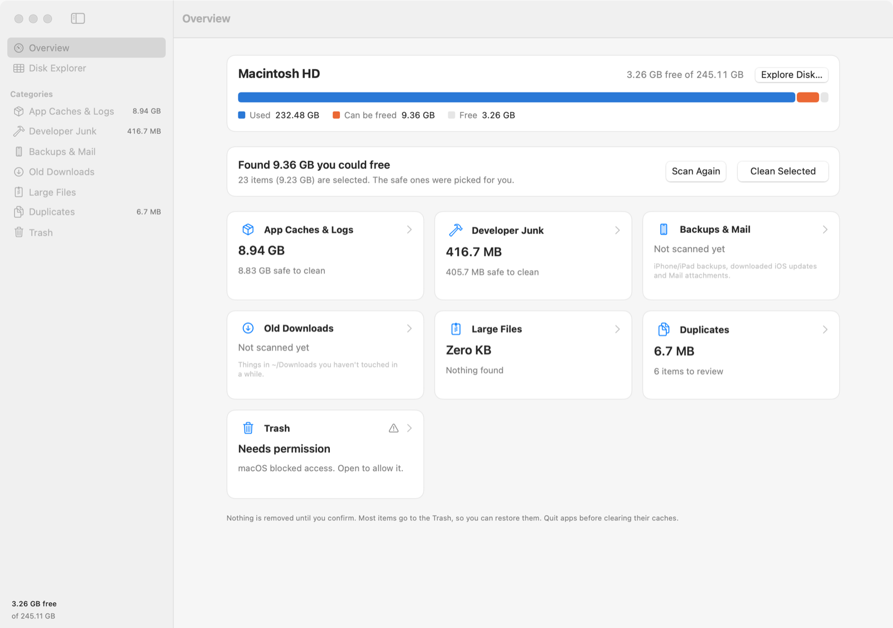
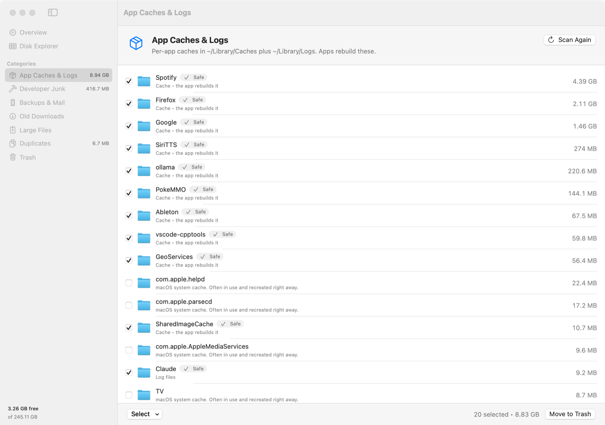
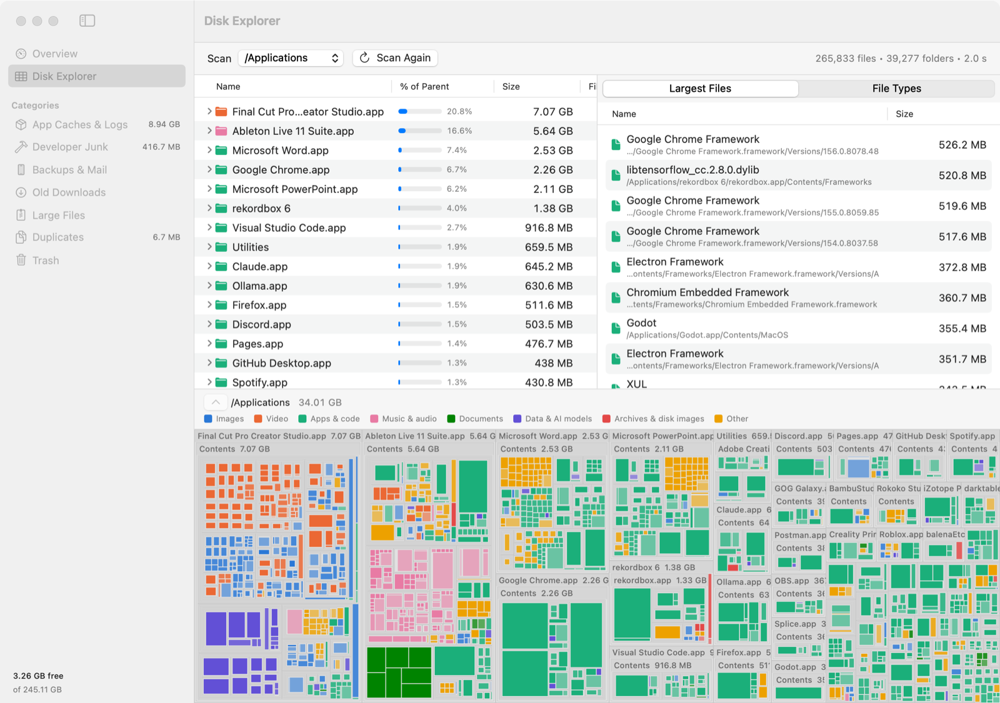
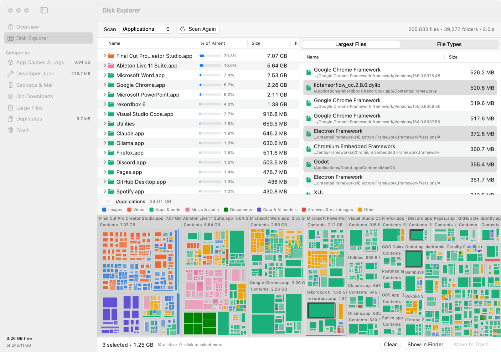
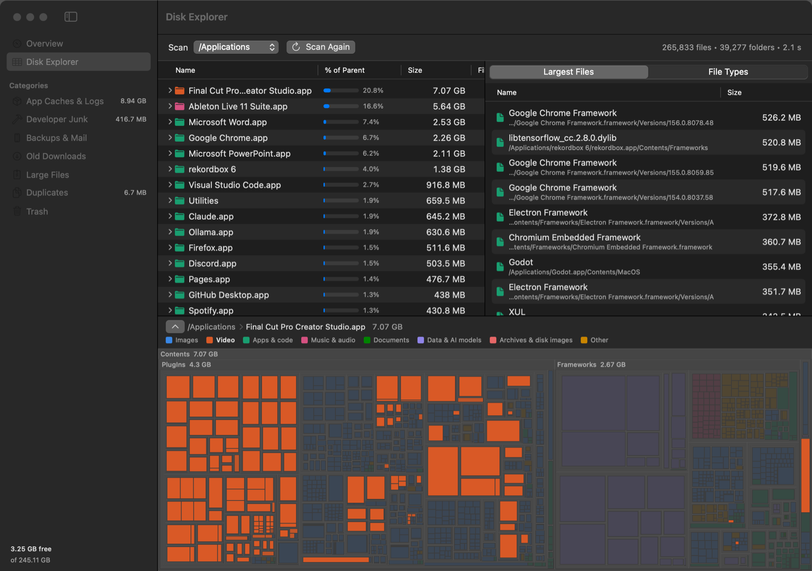

# Mac Cleaner

**See what's filling your Mac's disk, and clear it safely.**

A native macOS app that combines two tools:

- **Smart cleanup**: finds caches, developer junk, old downloads, duplicates and more, and pre-selects what's safe to remove.
- **Disk Explorer**: a WizTree-style map of your whole disk, so you can see exactly where the space went.




---

## Features

### Overview & Smart Scan

One button scans every category at once. The disk bar shows how much of your used space can be freed, and **Clean Selected**
removes everything that's ticked, with a confirmation first. While a scan runs you see live progress (files checked, current
folder), and you can stop it at any time.

### Cleanup categories

| Category | What it finds | Pre-selected as safe |
| --- | --- | --- |
| **App Caches & Logs** | Per-app folders in `~/Library/Caches` and `~/Library/Logs`, shown with real app names | Yes, except macOS's own caches |
| **Developer Junk** | Xcode DerivedData, device support files, simulator caches, Homebrew, npm, Yarn, pnpm, pip, CocoaPods, Cargo, Gradle and Go caches, Docker images and build cache, unavailable simulators, `node_modules` | Caches yes. `node_modules` only if untouched for 30+ days. Docker and simulators never |
| **Backups & Mail** | iPhone/iPad backups, downloaded iOS updates, Mail attachments you've opened | iOS updates and Mail attachments yes, backups never |
| **Old Downloads** | Items in `~/Downloads` older than an age you choose | Installers and archives (`.dmg`, `.pkg`, `.zip`, …) |
| **Large Files** | Files over a size you choose, with when you last opened them | Never |
| **Duplicates** | Byte-for-byte identical files (size → first 64 KB → full SHA-256), keeping the oldest copy | Never (one click selects the extra copies) |
| **Trash** | What's already in the Trash, the only place emptying actually frees space | Never |



### Disk Explorer (WizTree-style)

Pick **Macintosh HD**, your home folder, or any folder and scan it. It's fast: `/Applications` (265k files) takes about 1–2
seconds, and `/System` (470k files and folders) about 4.

- **Folder tree** sorted biggest-first, with a "% of parent" bar on every row
- **Largest Files**: the 1,000 biggest files anywhere on the disk, in one list
- **File Types**: total size and count per extension
- **Treemap**: every block's area is the space it takes, colored by type (images, video, apps & code, music, documents,
  data & AI models, archives & disk images, other). Double-click a block to zoom in, and click a legend entry or a file type
  to highlight just those files.
- **Multi-select**: ⌘/⇧-click in the lists or ⌘-click on the map, then **Show in Finder** or **Move to Trash** all at once





It also comes in dark mode:



---

## Install

There's no pre-built download yet, so you build it from source. It takes about a minute, and you don't need full Xcode.

**You'll need:**

- macOS 14 Sonoma or later
- Apple's Command Line Tools: `xcode-select --install`

```bash
git clone https://github.com/EvanMeyer36/mac-cleaner.git
cd mac-cleaner
./scripts/build-app.sh --install
```

This builds **Mac Cleaner.app** and copies it to `/Applications`. Open it from Spotlight (⌘ Space → "Mac Cleaner").

- Without `--install`, the app is only built into `build/`.
- For quick development runs, `swift run` works too.

### Permissions

macOS will ask the first time Mac Cleaner looks in Desktop, Documents or Downloads. Some places need **Full Disk Access**
(System Settings → Privacy & Security → Full Disk Access):

- the Trash
- iPhone backups
- other apps' data

Whenever something was blocked, the app shows a button that takes you straight to the right settings page. In the Disk
Explorer, space it couldn't read shows up as one hatched "System data" block, so the map still adds up to your real disk usage.

The app is signed ad-hoc (built on your own Mac, not notarized), so macOS may ask for these permissions again after you rebuild it.

---

## Safety

Deleting the wrong thing is the worst thing a cleaner can do, so the app is cautious by default:

- **Scanning never changes anything.** Nothing is removed until you confirm, and the confirmation lists what's about to go.
- **Almost everything goes to the Trash**, so you can put it back. Only two things are permanent, and both are labelled
  **Permanent** and called out before you confirm:
  - emptying the Trash itself
  - Docker and simulator cleanup, which the tools themselves do (`docker image prune`, `xcrun simctl delete unavailable`)
- **Only "safe" items are pre-selected**: things apps rebuild on their own.
- **Some things are never removed**:
  - pieces of apps or media libraries such as Photos, Music, iMovie and Final Cut. Deleting a file like `Photos.sqlite-wal`
    from inside the Photos library can corrupt it.
  - standard folders like Documents or Library
  - anything outside your home folder and `/Applications`
- **Duplicates that wouldn't free anything** (APFS clones and hard links) are left out.
- **The file-by-file searches skip `~/Library`, app bundles and `node_modules`.** Those are covered by the targeted
  categories instead.

---

## How it works

### Disk Explorer scanner

`Sources/MacCleaner/Explorer/DiskTreeScanner.swift` reads directories with
[`getattrlistbulk(2)`](https://developer.apple.com/library/archive/documentation/System/Conceptual/ManPages_iPhoneOS/man2/getattrlistbulk.2.html).
Each call returns the names, types and allocated sizes of many entries at once, and folders are spread across all CPU cores.

- Hard links are counted once, so totals match `du`.
- Files under 256 KB are grouped per folder, which keeps memory bounded on disks with millions of files.
- On the startup disk it skips the firmlinked Data volume (already reached through `/Users` and friends), other volumes and
  cloud-provider folders.

### Treemap

`TreemapLayout.swift` uses the squarified algorithm (Bruls, Huizing & van Wijk) and lays out breadth-first, so when there
isn't room the smallest, deepest detail is what gets dropped. Folders too small to show their contents are drawn in the color
of the file type that takes the most space inside them.

### Cleanup scans

Each category scan runs on its own background task, reports progress through a lock-guarded object the UI samples a few times
a second, and stops right away when cancelled. Before anything is removed, overlapping selections are de-duplicated: the same
file found by two categories, or something inside a folder that's also being removed.

### Project layout

| Path | What's there |
| --- | --- |
| `Sources/MacCleaner/Scanning` | Cleanup-category scanners |
| `Sources/MacCleaner/Explorer` | Disk Explorer: bulk scanner, tree model, treemap layout |
| `Sources/MacCleaner/Cleaning` | Removal engine |
| `Sources/MacCleaner/Views` | SwiftUI screens |
| `AppBundle/` | `Info.plist` and app icon |
| `scripts/` | `build-app.sh` (build/install), `make-icon.swift` (regenerate the icon) |

---

## Known limitations

- There's no notarized download yet, so you build from source.
- `build-app.sh` builds for your Mac's own architecture. It's been tested on Apple Silicon, not on Intel Macs.
- There are no automated tests yet. The scanners were checked against folders with known contents, and the Disk Explorer's
  totals against `du`.
- Without Full Disk Access, some folders (the Trash, Mail, iPhone backups, other apps' data) can't be scanned.

---

## Vibe coded

This app was **vibe coded**. It was built entirely through conversation with [Claude Code](https://claude.com/claude-code),
Anthropic's AI coding agent: a human described what they wanted ("make it work like WizTree", "more color, no grey", "can't
select multiple files") and steered from there, and the AI wrote the code, built it, tested the scanners and checked the UI
along the way.

The safety rails above were taken seriously, and several came out of testing (e.g. not letting you trash files inside apps or
the Photos library). Still, it's a disk cleaner written this way, so read the code, and keep a backup before you clean
anything you care about.

Issues and pull requests are welcome.

## License

MIT. See [LICENSE](LICENSE).
